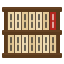
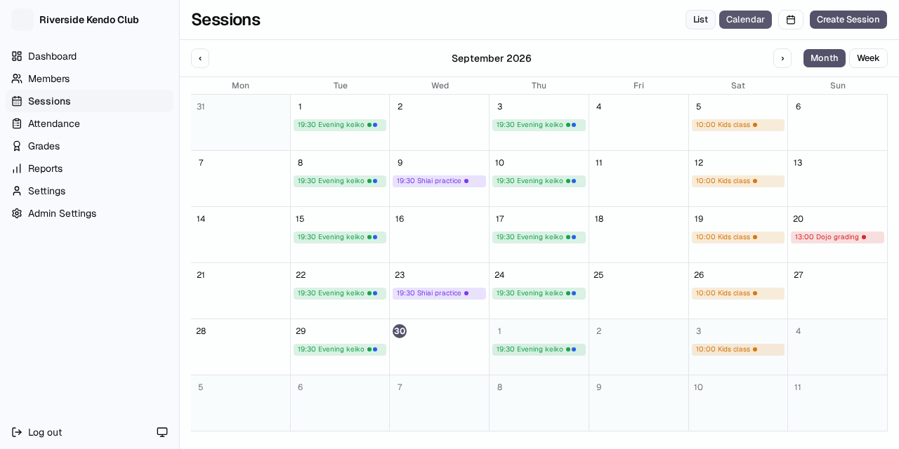
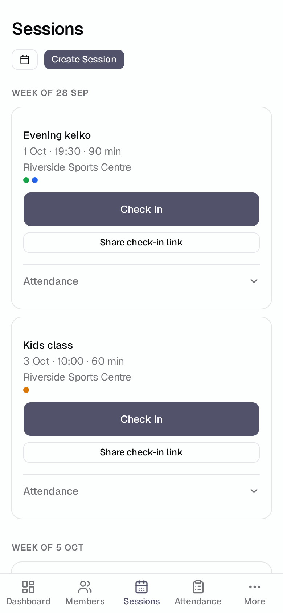

<div align="center">

</div>

# KendoDojoManagement

Self-hosted web application for managing the members, sessions, and attendance of a kendo dojo. Single-dojo per instance, deployed with rootless Podman.

<picture>
  <source media="(prefers-color-scheme: dark)" srcset="docs/assets/session-calendar-dark.png">
  
</picture>

<picture>
  <source media="(prefers-color-scheme: dark)" srcset="docs/assets/session-calendar-mobile-dark.png">
  
</picture>

<!-- --8<-- [start:features] -->
## Features

- **Members** — full profile management with grade history, coach/first-aider flags, and under-18 safeguarding fields
- **Sessions** — recurring templates and ad-hoc sessions with per-type colour coding, iCal feed, and a calendar/list toggle view
- **Attendance** — self check-in, one shareable check-in link per session, admin overrides, and visitor records
- **Grades** — enforced kendo grade progression (Mukyū → 8-dan) with full audit trail
- **Federations** — per-member federation memberships with membership numbers and renewal tracking. The catalogue starts empty; add the federations your dojo uses in Admin Settings. The [FIK affiliate list](https://www.kendo-fik.org/organization/affiliate) is the authoritative source for official names, abbreviations and websites.
- **Reports** — attendance and member-grade reports with CSV export
- **Auth** — passkey (WebAuthn) primary, recovery codes, admin-issued recovery tokens, and break-glass CLI token
- **Security** — rate limiting, account lockout, security headers, CORS, and structured security event logging
<!-- --8<-- [end:features] -->

## Documentation

**<https://booji.github.io/KendoDojoManagement/>** — the same pages as
[`docs/`](docs/), with navigation and search, one version per major release
(an operator on the `:1` image reads the `1.x` docs).

- **Install** — [Quick self-host](docs/install/quick-self-host.md) ·
  [Hardened deployment](docs/deployment.md) ·
  [Upgrading](docs/install/upgrading.md) · [Backups](docs/install/backups.md)
- **Operating** — [Claiming the admin account](docs/operating/claim-admin.md) ·
  [Break-glass recovery](docs/operating/break-glass.md) ·
  [Day-2 operations](docs/operating/day-2.md)
- **Reference** — [Environment variables](docs/reference/environment.md) ·
  [Container architecture](docs/reference/container-architecture.md) ·
  [Database schema](docs/schema.md) · [Glossary](UBIQUITOUS_LANGUAGE.md) ·
  [Decisions (ADRs)](docs/adr/)
- **Contributing** — [Dev stack](docs/contributing/dev-stack.md) ·
  [Make targets](docs/contributing/make-targets.md) ·
  [Running tests](docs/contributing/tests.md) ·
  [TDD workflow](docs/contributing/tdd.md)

Quickest start, on a host with Podman:

```bash
podman run --rm ghcr.io/booji/kendodojomanagement:1 init | tar -x
./setup.sh          # asks for your domain, writes .env and the Traefik config
./setup.sh check    # green? then:
podman-compose up -d
```

Podman is the supported runtime; Docker is best-effort — see
[Container runtime](docs/index.md#container-runtime).

The site builds with `mkdocs serve` after `pip install -r requirements-docs.txt`.

## Licence

KendoDojoManagement is licensed under the GNU Affero General Public License,
version 3 or later (`AGPL-3.0-or-later`); see [LICENSE](LICENSE). You may run,
modify and share it. Copies you share must come with their source code under
the same licence, and if you run a modified version for other people over a
network, you must offer them its source code too.
