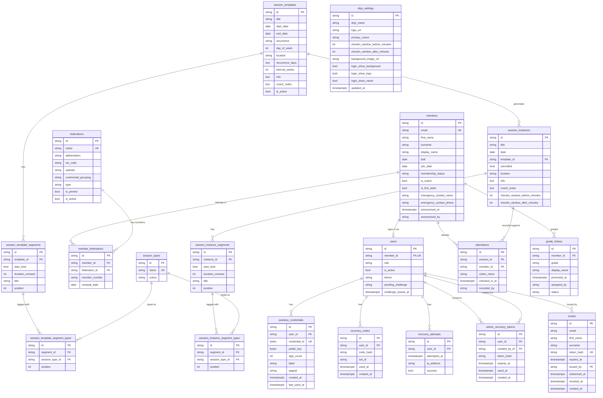

# Database Schema

Generated by reading `Base.metadata` — every table, column and constraint below
was taken from the ORM, not from memory. If you change a model, re-derive this
rather than patching it by hand:

```bash
podman-compose -f docker-compose.test.yml run --rm --entrypoint python test-backend -c "
from app.db.base import Base
import app.main  # noqa: F401 - imports every model module
for t in sorted(Base.metadata.tables):
    print(t, [(c.name, str(c.type), c.nullable) for c in Base.metadata.tables[t].columns])
"
```

Primary keys are UUIDs throughout (`UUIDBase`); `string id PK` below is the
mermaid rendering of that, not a varchar.



## Notes

- **Authentication has no password column.** Passkeys are the only login path
  (#155); `users` carries the WebAuthn challenge fields and nothing else.
  `recovery_codes` and `admin_recovery_tokens` hold bcrypt hashes;
  `invites.token_hash` is a deterministic sha256 digest (it is looked up by
  value — see `app/auth/invite_service.py` for why that differs).
- **`recovery_attempts` retention** (#434). A successful attempt deletes that
  Account's earlier rows, leaving only the success. Rows that remain (an
  Account that keeps failing) are kept — lockout counts failures since the
  last success with no time window, so deleting by age would expire lockouts
  — but `ip_address` is cleared to NULL once a row is 30 days old
  (`IP_RETENTION` in `app/auth/attempt_repository.py`). There is no scheduler:
  the clear runs on every `log_attempt`, for all Accounts, so an address can
  outlive 30 days until the next recovery attempt anywhere on the instance.
- **One WebAuthn ceremony per Account** (#435). `users.pending_challenge` /
  `challenge_issued_at` hold a single challenge, so a second concurrent
  registration or login for the same Account overwrites the first, which
  then fails. A known single-flight limit, accepted at dojo scale.
- **Every Account belongs to exactly one Member** (#432, ADR-0006).
  `users.member_id` is a live link and is enforced: NOT NULL, UNIQUE, and a
  foreign key to `members.id` with ON DELETE RESTRICT (Members are
  deactivated or anonymised, never hard-deleted). Most Members have no
  Account. The email lives once, on the Member — `members.email` is both the
  contact address and the sign-in identifier; `users` has no email column.
- **Audit columns are not foreign keys.** `attendance.recorded_by`,
  `grade_history.assigned_by` and `members.anonymised_by` record which Account
  acted. They are deliberately not FK-enforced, so the id outlives the
  Account it names: erasing a member deletes their Account, and the history
  that Account recorded must not cascade with it.
- **`grade_history.display_name` is deliberately denormalised** (#435). It is
  derivable from `grade` today, but it records what was displayed at the time
  of the **Promotion**, which is the point of an audit table.
- **Constraints beyond keys** (#431). The database, not just the app, refuses:
  - `uq_attendance_session_member` — UNIQUE `(session_id, member_id)` on
    `attendance`: a member is checked in at most once per session. NULLs are
    distinct, so any number of visitor rows (`member_id` NULL) per session
    stay legal. This, not the router's existence check, decides a concurrent
    double check-in (the loser gets 409).
  - `ck_attendance_member_xor_visitor` — CHECK on `attendance`: exactly one of
    `member_id` / `visitor_name` is set.
  - `uq_member_federations_member_federation` — UNIQUE
    `(member_id, federation_id)`: one membership per member per federation.
  - `uq_dojo_settings_single_row` — a unique index on the constant `(true)`:
    `dojo_settings` holds one row.
  - `uq_federations_name` — UNIQUE `federations.name`.
- **Index policy** (#418). No indexes beyond those that keys and constraints
  create and the `index=True` lookup columns on the ORM. Add one when a query
  is measured slow — at dojo scale a sequential scan is microseconds.
- **Federation membership is a table, not a column.** `members` has no
  `federation_number`: a member can hold numbers with several federations, so
  it lives in `member_federations` (dropped from `members` in #297 — see
  `a5b6c7d8e9f0_drop_federation_number_from_members.py`).
- **Sessions are segmented.** `session_templates`/`session_instances` carry no
  single `session_type_id`/`start_time`/`duration_minutes`. Each session has
  one or more **segments**, each with its own `start_time`/`duration_minutes`/
  optional public `title`/`position`, and each segment links to one or more
  session types via the `*_segment_types` join tables (also ordered by
  `position`). A session's time envelope (for calendar display) is derived as
  min(segment start) → max(segment end) — see `app/sessions/envelope.py`.
  Segments have no notes of their own: per-segment `coach_notes` went in #190
  and the public per-segment `note` in #406. Prose about a session belongs in
  the session-level `info` (public) or `coach_notes` (admin-only).
- `session_instances.title` is required (no longer derived from session type).
- `session_instances.checkin_window_*` override the dojo-wide defaults in
  `dojo_settings` when set; null means "use the dojo default".
- All `*_segments`/`*_segment_types` child rows cascade-delete with their
  parent (`ondelete="CASCADE"` at the DB level, `cascade="all, delete-orphan"`
  at the ORM level) and are fully replaced (delete+recreate) on update — there
  is no row-level PATCH of an individual segment.
