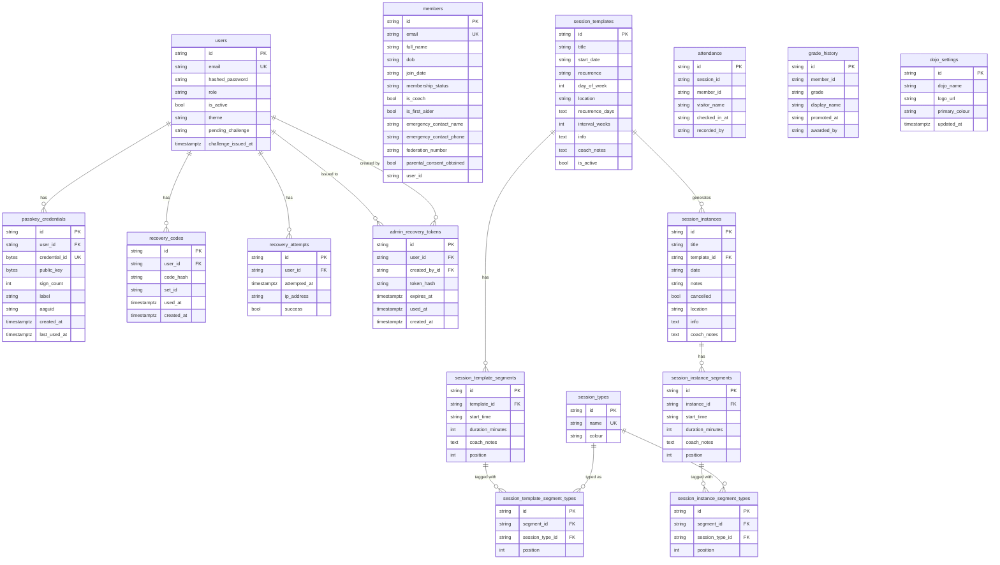

# Database Schema

## Notes

- `attendance`, `grade_history` — `session_id`, `member_id`, `recorded_by` are bare strings with no FK constraints enforced at DB level.
- `members.user_id` — links a member to a user account but also unconstrained at DB level.
- Sessions (`session_templates`/`session_instances`) no longer carry a single `session_type_id`/`start_time`/`duration_minutes`. Each session has one or more **segments** (`session_template_segments`/`session_instance_segments`), each with its own `start_time`/`duration_minutes`/`coach_notes`/`position`, and each segment links to one or more session types via the `*_segment_types` join tables (also ordered by `position`). A session's overall time envelope (for calendar display) is derived as min(segment start) → max(segment end) — see `app/sessions/envelope.py`.
- `session_instances.title` is required (no longer derived from session type).
- All `*_segments`/`*_segment_types` child rows cascade-delete with their parent (`ondelete="CASCADE"` at the DB level, `cascade="all, delete-orphan"` at the ORM level) and are fully replaced (delete+recreate) on update — there is no row-level PATCH of an individual segment.
